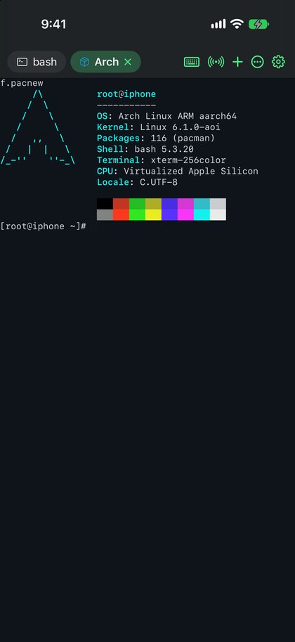
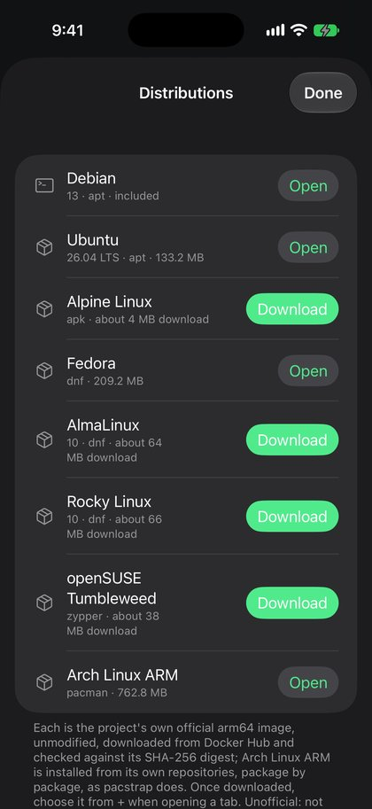
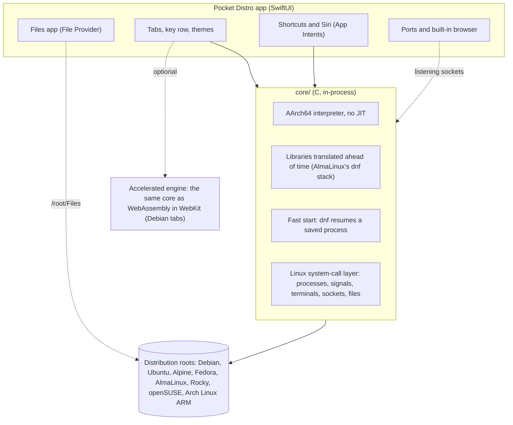

<h1 align="center">Pocket Distro: real Linux on iPhone</h1>

<b>Eight unmodified Linux distributions on a normal, non-jailbroken iPhone and iPad, from the App Store.</b> 
Debian 13 comes with the app; Ubuntu, Alpine Linux, Fedora, AlmaLinux, Rocky Linux, openSUSE and Arch Linux ARM are one tap away. Real apt, dnf, zypper, pacman and apk; Python, git, SSH and tmux; web servers started with systemctl; servers that open in a built-in browser; commands from Shortcuts and Siri. Free, no ads, no in-app purchases, open source.

Website: https://pocketdistro.com · Pocket Distro was called **LxTerm** until November 2026; the App Store listing still carries that name until the next store release.
Status: 1.0.1 is on the App Store; 1.0.2 (faster dnf, systemctl, Repair) is in TestFlight. See [`CHANGELOG.md`](CHANGELOG.md).

## Distributions

| Distribution | Package manager | Where it comes from | Checked by |
|---|---|---|---|
| Debian 13 | apt | bundled in the app (`debian:trixie-slim` plus a few packages, installed by apt) | image digests at build time |
| Ubuntu 26.04 LTS | apt | official image `ubuntu:26.04`, downloaded on demand | manifest and layer SHA-256 |
| Alpine Linux | apk | official image `alpine:latest` | manifest and layer SHA-256 |
| Fedora | dnf | official image `fedora:latest` | manifest and layer SHA-256 |
| AlmaLinux 10 | dnf | official image `almalinux:10` | manifest and layer SHA-256 |
| Rocky Linux 10 | dnf | official image `rockylinux/rockylinux:10` | manifest and layer SHA-256 |
| openSUSE Tumbleweed | zypper | official image `opensuse/tumbleweed` | manifest and layer SHA-256 |
| Arch Linux ARM | pacman | its own repositories, package by package, as pacstrap does | repository SHA-256, then pacman's signature checks |

None is modified. Each runs in its own tabs and colours; pick a default, repair, reset or remove any of them in Settings › Distributions.

## What you get

- **A real system:** the distributions' own arm64 programs, their package managers with maintainer scripts and hooks, Python and pip (compiled wheels included), git, ssh, tmux, job control (Ctrl-C, Ctrl-Z, `fg`, `bg`).
- **Services:** `systemctl start/stop/enable` for programs such as httpd and nginx (a small systemctl of the app's own, no init system); enabled services start again when a tab opens.
- **Ports:** servers you start (`python3 -m http.server`, Flask, Jupyter) are listed with the program that opened them and open in a built-in browser.
- **Shortcuts and Siri:** run a command or a saved command, pass text in, send the output to other apps, run it every day with an automation. Seven ready-made tools: weather where you are, is a site up, your network, exchange rates, a strong password, a word's definition, Hacker News.
- **Files:** `/root/Files` is in the Files app (Locations), shared by every distribution; any file can be opened in Pocket Distro.
- **Made for the phone:** a key row with Esc, Ctrl, Tab, arrows and F keys, hardware keyboard shortcuts, saved commands, search in the output, two terminals side by side on iPad and in landscape, themes, fonts, automatic light and dark; the screen stays on while a command runs.

## Speed

iOS lets no app generate machine code, so every program is interpreted. Four things make the package tools fast anyway; measured on an iPhone with AlmaLinux 10:

| `dnf --version` | Time |
|---|---:|
| interpreter only | 4.2 s |
| + host libc string functions, hardware AES/SHA, DNS fix | 3.8 s |
| + libraries translated ahead of time | 2.0 s |
| + fast start (a saved dnf process) | **0.39 s** |

Details, CI numbers for every workload and how to reproduce them: [`docs/PERFORMANCE.md`](docs/PERFORMANCE.md). How the pieces fit: [`docs/ARCHITECTURE.md`](docs/ARCHITECTURE.md).

## How it works

Pocket Distro brings its own AArch64 interpreter (`core/cpu.c`, `core/simd.c`) and a Linux system-call layer on top of Darwin (`core/proc.c`, `core/tty.c`): `fork` copies the address space, `execve` replaces it in place, and processes, groups, signals, terminals with Linux's line discipline, sockets and files behave as the distributions expect. Every program, from `bash` to `dnf`, is the distribution's own binary, run inside the app's sandbox; the app's own code, including the translated libraries, is fixed at build time.

| Path | What it is |
|---|---|
| `core/` | the interpreter and the Linux layer (`core/UPSTREAM` names the core commit it was copied from) |
| `lxios/LxTerm/` | the iOS app: SwiftUI and SwiftTerm, sessions, distributions (`Distros.swift`, `Pacstrap.swift`), Ports, App Intents, systemctl |
| `lxios/LxTermFiles/` | the File Provider extension (Files app) |
| `lxios/web/`, `lxios/webjs/` | the accelerated engine: the core built for WebAssembly, run in a hidden web view |
| `tools/` | `aotgen.c` and `aot-build.sh`: the ahead-of-time translation, built in CI for the AlmaLinux image the app downloads |
| `scripts/`, `tests/` | building the bundled Debian, screenshots, host tests |

## How it is tested

- **Every change to the core** runs its Linux test suite on arm64: Debian and Alpine checks, real package installs with apt (Debian, Ubuntu), dnf (Fedora, AlmaLinux, Rocky Linux), zypper (openSUSE) and pacman (Arch Linux ARM, bootstrapped from its repositories with signature checks), Jupyter serving a page, dnf's fast start, and a differential test of the interpreter against a reference CPU.
- **The translated libraries** are only shipped when every check command gives the interpreter's output byte for byte (`tools/aot-build.sh`); otherwise the app is built without them.
- **This repository's CI** builds the app and runs it in the iOS simulator; `services.yml` starts httpd and nginx through systemctl.
- **TestFlight** (`testflight.yml`) builds the bundled root on Linux, the translation tables on arm64 Linux, signs on macOS and uploads; releases are tried on a real iPhone through TestFlight first.

## Limits, honestly

- **Speed:** still an interpreter. Shell work, editors, git, package managers and small Python scripts feel fine; heavy computing is several times slower than native. The speed-ups can be turned off in Settings to compare.
- **No init system, no graphical programs, no Docker.** Services run through the app's systemctl; programs that need systemd itself, or kernel features iOS does not give an app (namespaces, cgroups), do not run. MariaDB does not start yet.
- **One core per process:** processes run in parallel, the threads of one process take turns. No GPU.
- **In the background:** iOS suspends apps that are not on screen; servers keep running only while the app is open.

## Questions

**Can I run Linux on an iPhone without a jailbreak?** Yes: install Pocket Distro from the App Store. No jailbreak, no sideloading, no cloud machine.

**How is it different from iSH and a-Shell?** iSH emulates a 32-bit x86 PC (Alpine); a-Shell offers commands ported to iOS. Pocket Distro runs the distributions' own 64-bit ARM binaries, from their official images and mirrors.

**Can I use pip?** Yes: `apt install python3-pip` in Debian (or the distribution's equivalent); pip installs Linux packages from PyPI, including compiled ones such as polars.

## Build

- Host (Linux, arm64): `make build/lxrun`, `sh tests/linux/fetch-alpine.sh ~/alpine`, `build/lxrun -i ~/alpine /bin/sh -l`; checks in `tests/linux/`.
- The app: `xcodegen generate`, then build the `LxTerm` scheme in Xcode (see `.github/workflows/ci.yml` for the exact steps, including the bundled root and the WebAssembly engine).

## Contributing, security, conduct

[`CONTRIBUTING.md`](CONTRIBUTING.md) · [`SECURITY.md`](SECURITY.md) (report vulnerabilities privately) · [`CODE_OF_CONDUCT.md`](CODE_OF_CONDUCT.md) · contact: hello@pocketdistro.com

## License

GPL-3.0-or-later (`LICENSE`); contributions are accepted on the terms in `CONTRIBUTING.md` (which also let the official builds ship in the App Store). Third-party notices in `NOTICE.md`. Debian is a registered trademark of Software in the Public Interest, Inc.; AlmaLinux, Fedora, Rocky Linux, Ubuntu, openSUSE, Alpine Linux and Arch Linux are trademarks of their owners. Pocket Distro is not affiliated with or endorsed by any of these projects.

Other apps by the same author: [Tuple](https://heyobi.github.io/pgnotebook/) (PostgreSQL on iPhone).
