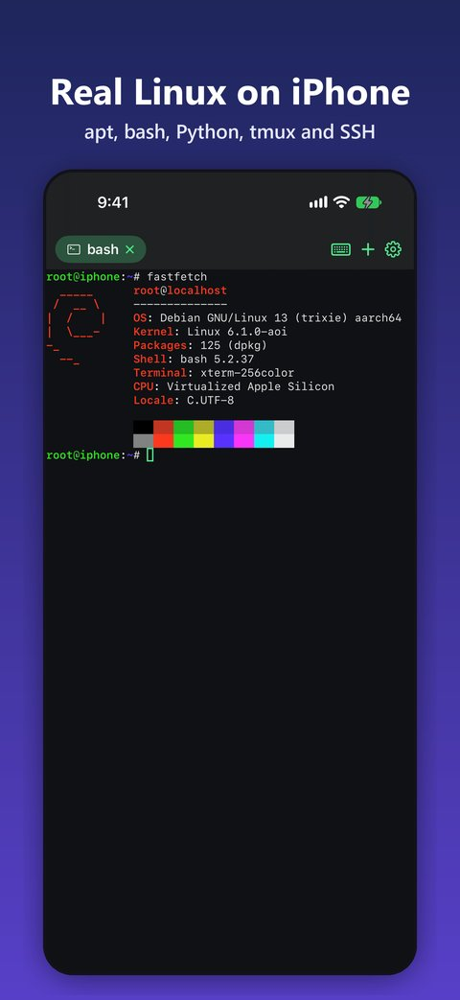
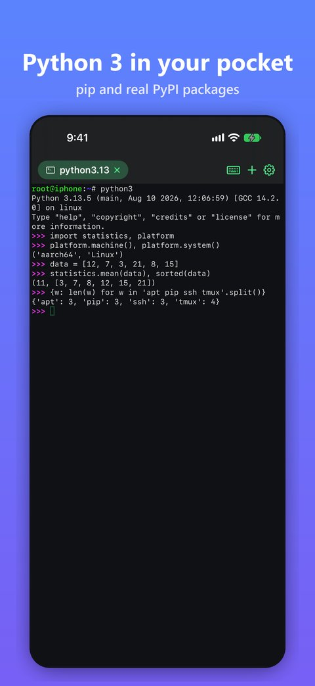
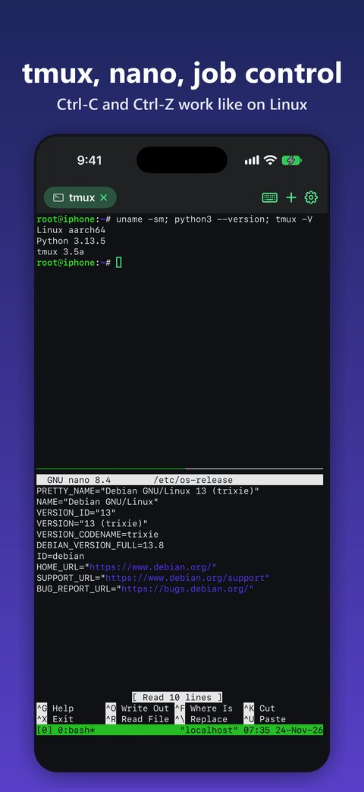
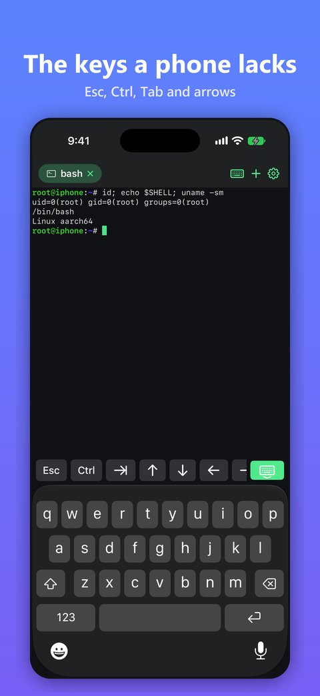
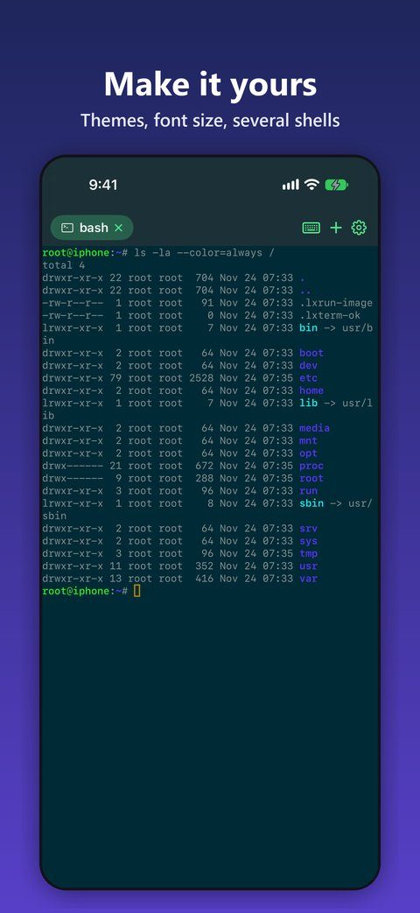

<p align="center"></p>
<h1 align="center">LxTerm: real Linux on iPhone</h1>
<p align="center"><b>Debian 13 runs unmodified on a normal, non-jailbroken iPhone and iPad.</b><br>
apt, bash, Python 3 and pip, git, SSH, tmux and nano, in a native terminal app. Offline, free, open source.</p>
<p align="center"><a href="https://apps.apple.com/app/id6838355342"></a></p>
<p align="center">





</p>

Website: https://heyobi.github.io/lxterm/ · Status: **submitted to the App Store** (in review, November 2026).

## Questions

**Can I run Linux on an iPhone without a jailbreak?** Yes. LxTerm runs Debian 13 for arm64 on the phone itself: Debian's own programs (glibc, bash, coreutils, dpkg, apt), unmodified, in a no-JIT AArch64 interpreter with an in-process Linux system-call layer. No jailbreak, no sideloading, no cloud machine.

**How do I use apt on my iPhone?** Type `apt update`, then `apt install <package>`, for example `apt install htop`. Packages come from Debian's own mirrors, maintainer scripts included.

**Can I run Python and pip on iPhone?** Yes. Python 3 is installed; `apt install python3-pip` adds pip, and pip installs Linux packages from PyPI, including compiled ones such as polars.

**SSH and tmux?** tmux is installed; `apt install openssh-client` adds ssh. Ctrl-C, Ctrl-Z, `fg` and `bg` work as on Linux.

**How is it different from iSH and a-Shell?** iSH emulates a 32-bit x86 PC (Alpine); a-Shell offers commands ported to iOS. LxTerm runs the distribution's own 64-bit ARM binaries, from Debian's images and mirrors.

**Is it fast?** Everything runs in an interpreter (iOS allows no JIT): shell work, editors, git and Python are comfortable, heavy computing is slow. A WebAssembly-based accelerator is being prototyped in the core.

What works: apt/dpkg with maintainer scripts, python3 and pip, git (https), ssh, tmux, job control (Ctrl-Z, fg, bg), ps/top, several tabs, sessions that come back after the app is closed. Not there: graphical programs, systemd services, Docker.

Other apps by the same author: [Tuple](https://heyobi.github.io/pgnotebook/) (PostgreSQL on iPhone), [Querly](https://heyobi.github.io/querly/) (CSV, Excel and DuckDB on iPhone).

## How it works

```
Debian arm64 binaries (unmodified)
        │  svc #0
core/proc.c   Linux syscalls on Darwin, Linux userland mode: processes (fork copies
              the address space, execve in place), pids/groups/signals between them,
              fake root, statx, sockets, DNS ...
core/tty.c    the terminal: pty slave with Linux's line discipline, termios, job control
core/cpu.c, simd.c   no-JIT AArch64 interpreter (Unicorn-difftested)
core/vm.c     sparse guest address space; core/snap.c snapshots
lxios/LxTerm/ the iOS app: SwiftUI + SwiftTerm, tabs, saved sessions, settings
```

The core comes from [LiquidAPK](https://github.com/heyobi/apk-on-iphone) (Android apps
on iPhone, same author), branch `linux-userland`, where it is developed and tested in
both modes; `core/UPSTREAM` names the commit copied here.

## Build and test

- Host (Linux): `make build/lxrun`, `sh tests/linux/fetch-alpine.sh ~/alpine`,
  `build/lxrun -i ~/alpine /bin/sh -l`; checks: `tests/linux/run_alpine.sh`,
  `run_debian.sh` (both with `net` for the package managers).
- CI (`.github/workflows/ci.yml`): Alpine and Debian checks on an arm64 runner, then
  the app in the iOS simulator (screenshots, measurements).
- TestFlight (`.github/workflows/testflight.yml`): roots built on Linux (python3
  installed by `apk`/`apt` running in the interpreter), signed on macOS, uploaded.

## License

GPL-3.0-or-later (`LICENSE`), third-party notices in `NOTICE.md`. Alpine Linux and
Debian are trademarks of their projects; LxTerm is not affiliated with or endorsed by
either.
