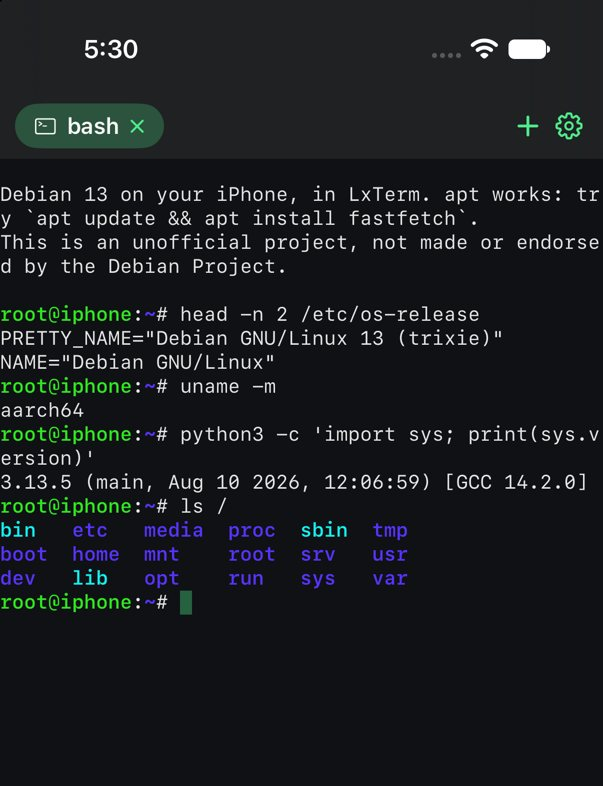
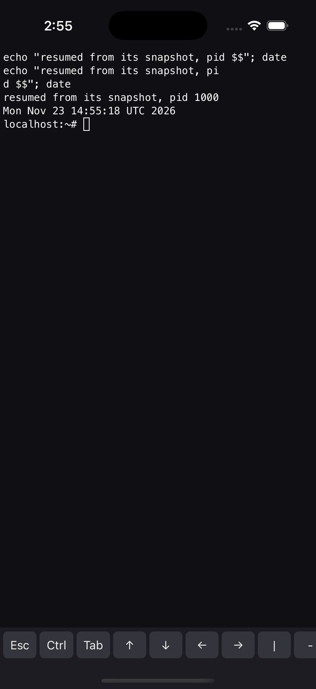

# LxTerm

**Debian on a non-jailbroken iPhone.** Debian 13's own arm64 programs (glibc, bash,
`dpkg`, `apt`, python, git, ssh, tmux) run unmodified on the phone itself, in a no-JIT AArch64 interpreter with an in-process Linux system-call layer:
real `fork`/`execve`, pipes, signals and job control, a terminal with Linux's line
discipline, and snapshots that bring a shell back in a fraction of a second.

Not an emulated PC (iSH emulates 32-bit x86) and not a set of ported commands
(a-Shell): the distributions' own arm64 binaries, from their own images and mirrors.

<p>


</p>

Status: **TestFlight beta.** What works: apt/dpkg with maintainer scripts, python3, git
(https), ssh, tmux, job control (Ctrl-Z, fg, bg), ps/top, several tabs, sessions that
come back after the app is closed. Not there: graphical programs, systemd services,
Docker; everything runs in an interpreter, so heavy computing is slow.

## How it works

```
Debian arm64 binaries (unmodified)
        │  svc #0
core/proc.c   Linux syscalls on Darwin, Linux userland mode: processes (fork copies
              the address space, execve in place), pids/groups/signals between them,
              fake root, statx, sockets, DNS ...
core/tty.c    the terminal: pty slave with Linux's line discipline, termios, job control
core/cpu.c, simd.c   no-JIT AArch64 interpreter (Unicorn-difftested)
core/vm.c     sparse guest address space; core/snap.c snapshots
lxios/LxTerm/ the iOS app: SwiftUI + SwiftTerm, tabs, saved sessions, settings
```

The core comes from [LiquidAPK](https://github.com/heyobi/apk-on-iphone) (Android apps
on iPhone, same author), branch `linux-userland`, where it is developed and tested in
both modes; `core/UPSTREAM` names the commit copied here.

## Build and test

- Host (Linux): `make build/lxrun`, `sh tests/linux/fetch-alpine.sh ~/alpine`,
  `build/lxrun -i ~/alpine /bin/sh -l`; checks: `tests/linux/run_alpine.sh`,
  `run_debian.sh` (both with `net` for the package managers).
- CI (`.github/workflows/ci.yml`): Alpine and Debian checks on an arm64 runner, then
  the app in the iOS simulator (screenshots, measurements).
- TestFlight (`.github/workflows/testflight.yml`): roots built on Linux (python3
  installed by `apk`/`apt` running in the interpreter), signed on macOS, uploaded.

## License

GPL-3.0-or-later (`LICENSE`), third-party notices in `NOTICE.md`. Alpine Linux and
Debian are trademarks of their projects; LxTerm is not affiliated with or endorsed by
either.
