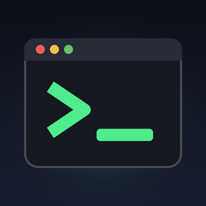
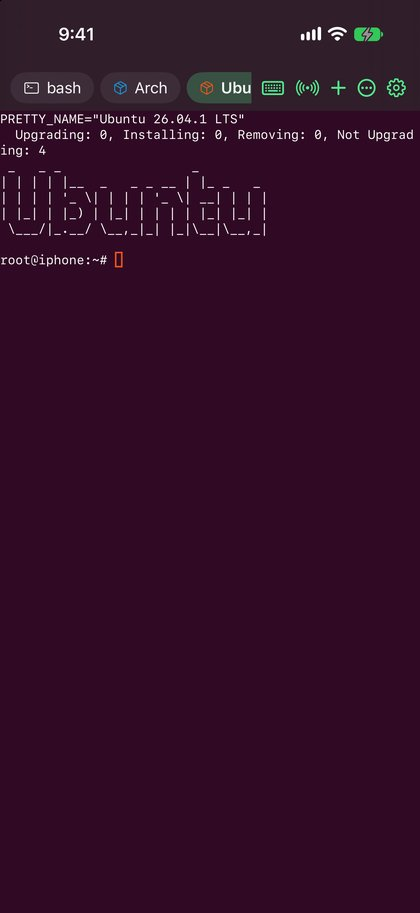
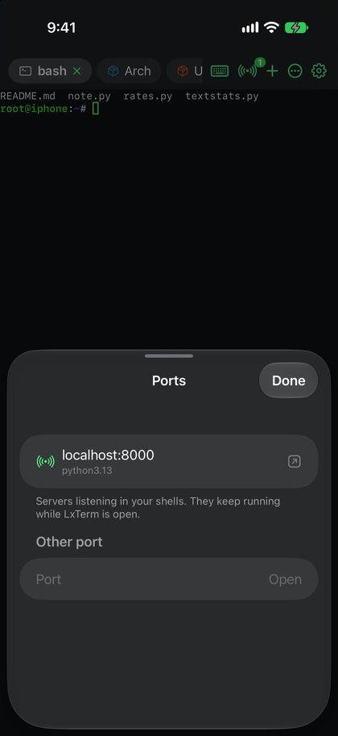
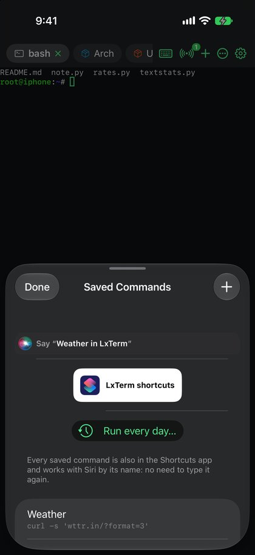
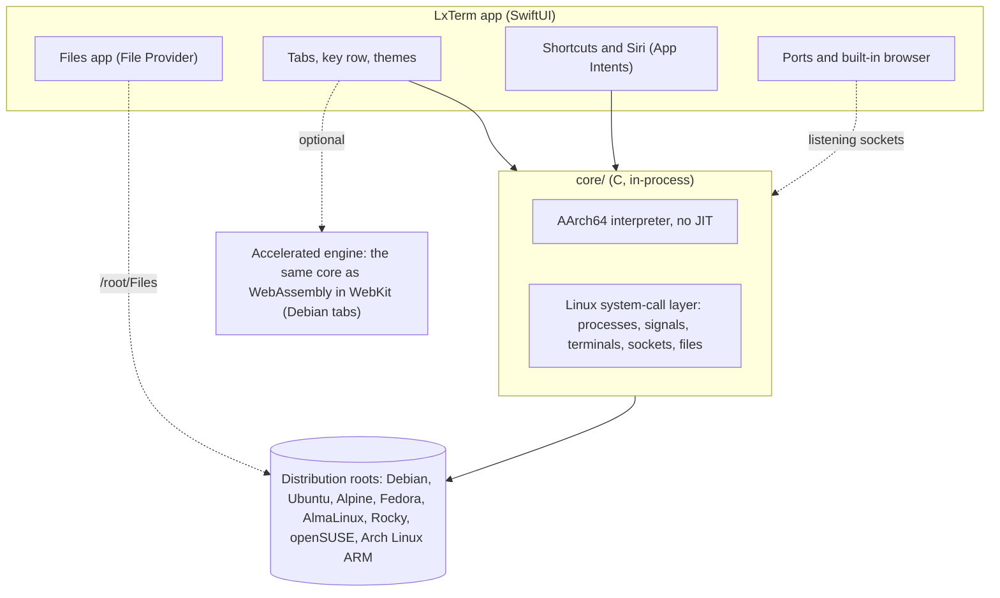

<h1 align="center">LxTerm: real Linux on iPhone</h1>

<b>Eight unmodified Linux distributions on a normal, non-jailbroken iPhone and iPad, from the App Store.</b> 
Debian 13 comes with the app; Ubuntu, Alpine Linux, Fedora, AlmaLinux, Rocky Linux, openSUSE and Arch Linux ARM are one tap away. Real apt, dnf, zypper, pacman and apk; Python, git, SSH and tmux; servers that open in a built-in browser; commands from Shortcuts and Siri. Free, no ads, no in-app purchases, open source.

Website: https://heyobi.github.io/lxterm/ · Status: 1.0 (Debian) is **on the App Store**; 1.0.1, with all eight distributions, Ports and Shortcuts, is in review (November 2026).

## Distributions

| Distribution | Package manager | Where it comes from | Checked by |
|---|---|---|---|
| Debian 13 | apt | bundled in the app (`debian:trixie-slim` plus a few packages, installed by apt) | image digests at build time |
| Ubuntu 26.04 LTS | apt | official image `ubuntu:26.04`, downloaded on demand | manifest and layer SHA-256 |
| Alpine Linux | apk | official image `alpine:latest` | manifest and layer SHA-256 |
| Fedora | dnf | official image `fedora:latest` | manifest and layer SHA-256 |
| AlmaLinux 10 | dnf | official image `almalinux:10` | manifest and layer SHA-256 |
| Rocky Linux 10 | dnf | official image `rockylinux/rockylinux:10` | manifest and layer SHA-256 |
| openSUSE Tumbleweed | zypper | official image `opensuse/tumbleweed` | manifest and layer SHA-256 |
| Arch Linux ARM | pacman | its own repositories, package by package, as pacstrap does | repository SHA-256, then pacman's signature checks |

None is modified. Each runs in its own tabs and colours; pick a default, reset or remove any of them in Settings › Distributions.

## What you get

- **A real system:** the distributions' own arm64 programs, their package managers with maintainer scripts and hooks, Python and pip (compiled wheels included), git, ssh, tmux, job control (Ctrl-C, Ctrl-Z, `fg`, `bg`).
- **Ports:** servers you start (`python3 -m http.server`, Flask, Jupyter) are listed with the program that opened them and open in a built-in browser.
- **Shortcuts and Siri:** run a command or a saved command, pass text in, send the output to other apps, run it every day with an automation. Seven ready-made tools: weather where you are, is a site up, your network, exchange rates, a strong password, a word's definition, Hacker News.
- **Files:** `/root/Files` is in the Files app (Locations), shared by every distribution; any file can be opened in LxTerm.
- **Made for the phone:** a key row with Esc, Ctrl, Tab, arrows and F keys, hardware keyboard shortcuts, saved commands, search in the output, two terminals side by side on iPad and in landscape, themes, fonts, automatic light and dark.

## How it works

iOS lets no app generate machine code, so LxTerm brings its own AArch64 interpreter (`core/cpu.c`, `core/simd.c`) and a Linux system-call layer on top of Darwin (`core/proc.c`, `core/tty.c`): `fork` copies the address space, `execve` replaces it in place, and processes, groups, signals, terminals with Linux's line discipline, sockets and files behave as the distributions expect. Every program, from `bash` to `dnf`, is the distribution's own binary, interpreted instruction by instruction inside the app's sandbox; the app's own code is fixed at build time.

| Path | What it is |
|---|---|
| `core/` | the interpreter and the Linux layer (`core/UPSTREAM` names the core commit it was copied from) |
| `lxios/LxTerm/` | the iOS app: SwiftUI and SwiftTerm, sessions, distributions (`Distros.swift`, `Pacstrap.swift`), Ports, App Intents |
| `lxios/LxTermFiles/` | the File Provider extension (Files app) |
| `lxios/web/`, `lxios/webjs/` | the accelerated engine: the core built for WebAssembly, run in a hidden web view |
| `scripts/`, `tests/` | building the bundled Debian, screenshots, host tests |

## How it is tested

- **Every change to the core** runs its Linux test suite on arm64: Debian and Alpine checks, then real package installs with apt (Debian, Ubuntu), dnf (Fedora, AlmaLinux, Rocky Linux), zypper (openSUSE) and pacman (Arch Linux ARM, bootstrapped from its repositories with signature checks), plus Jupyter serving a page over localhost.
- **This repository's CI** (`ci.yml`) builds the app and runs it in the iOS simulator: it downloads distributions the way the app does, runs commands in them, checks that servers appear under Ports, and exercises the accelerated engine.
- **TestFlight** (`testflight.yml`) builds the bundled root on Linux, signs on macOS and uploads; releases are tried on a real iPhone through TestFlight first.

## Limits, honestly

- **Speed:** an interpreter is slower than native code. Shell work, editors, git and small Python scripts feel fine; starting a big program takes seconds (`dnf` about 3–4 s), heavy computing is slow. The accelerated engine makes long jobs several times faster in Debian tabs.
- **No systemd services, no graphical programs, no Docker.** Package managers work; daemons that need an init system do not start.
- **In the background:** iOS suspends apps that are not on screen; servers keep running only while LxTerm is open.

## Questions

**Can I run Linux on an iPhone without a jailbreak?** Yes: install LxTerm from the App Store. No jailbreak, no sideloading, no cloud machine.

**How is it different from iSH and a-Shell?** iSH emulates a 32-bit x86 PC (Alpine); a-Shell offers commands ported to iOS. LxTerm runs the distributions' own 64-bit ARM binaries, from their official images and mirrors.

**Can I use pip?** Yes: `apt install python3-pip` in Debian (or the distribution's equivalent); pip installs Linux packages from PyPI, including compiled ones such as polars.

## Build

- Host (Linux, arm64): `make build/lxrun`, `sh tests/linux/fetch-alpine.sh ~/alpine`, `build/lxrun -i ~/alpine /bin/sh -l`; checks in `tests/linux/`.
- The app: `xcodegen generate`, then build the `LxTerm` scheme in Xcode (see `.github/workflows/ci.yml` for the exact steps, including the bundled root and the WebAssembly engine).

## License

GPL-3.0-or-later (`LICENSE`); contributions are accepted on the terms in `CONTRIBUTING.md` (which also let the official builds ship in the App Store). Third-party notices in `NOTICE.md`. Debian is a registered trademark of Software in the Public Interest, Inc.; the other distributions' names are trademarks of their owners. LxTerm is not affiliated with or endorsed by any of these projects.

Other apps by the same author: [Tuple](https://heyobi.github.io/pgnotebook/) (PostgreSQL on iPhone).
