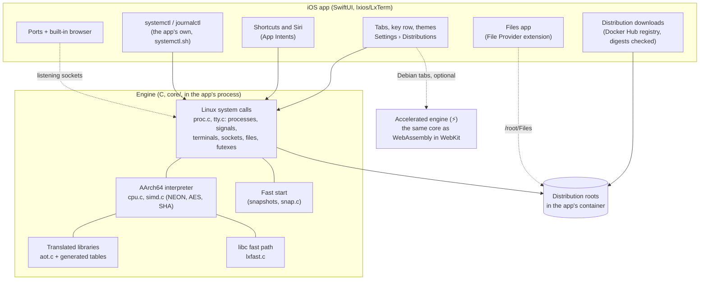
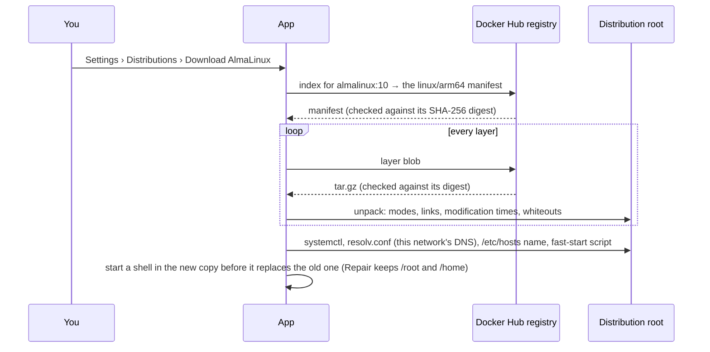
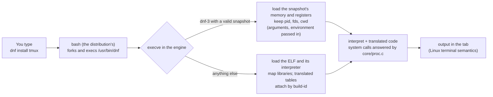
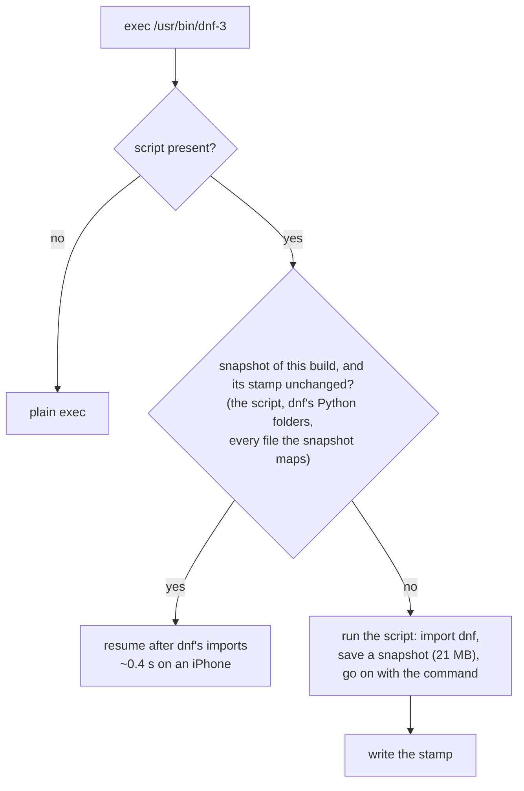
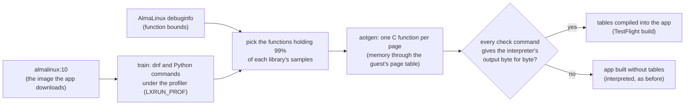

# Architecture

Pocket Distro runs a distribution's own arm64 programs inside an ordinary iOS app. There is no virtual machine and no kernel: the app interprets the programs' instructions and answers their Linux system calls itself. This page walks through the pieces, from a tap on "Download" to `dnf` starting in 0.4 s.

## The pieces

| Piece | Files | What it does |
|---|---|---|
| Interpreter | `core/cpu.c`, `core/simd.c` | Executes AArch64 instructions one by one (computed-goto loop), NEON and the crypto extension included. |
| System calls | `core/proc.c`, `core/tty.c` | Linux's system calls on top of Darwin: `fork` copies the address space, `execve` replaces it in place; each process runs on its own iOS thread, the threads of one process take turns on it. Terminals follow Linux's line discipline. |
| libc fast path | `core/lxfast.c` | glibc's `memcpy`, `strlen`, `strcmp` and twelve more run as the app's own code when glibc is mapped. |
| Translated libraries | `core/aot.c`, `tools/aotgen.c`, `tools/aot-build.sh` | Hot functions of AlmaLinux's dnf stack compiled into the app; matched by build-id when a library is mapped. |
| Fast start | `core/snap.c`, `core/proc.c` (`aoi_proc_zygote`), `lxios/LxTerm/zygote-dnf.py` | `dnf` resumes a process saved after its imports. |
| App | `lxios/LxTerm/` | Sessions, distributions, Repair, systemctl, Ports, App Intents, settings. |
| Accelerated engine | `lxios/web/`, `lxios/webjs/` | The core compiled to WebAssembly, run in a hidden web view whose JIT compiles hot guest code. |

## A distribution arrives

## A command runs

## Fast start in detail

- An unrelated install (tmux, with ldconfig) keeps the snapshot: pages of files under `/etc` are stored in it, not looked up again.
- An update of dnf, Python or a library the snapshot maps, or a new app build, makes the next `dnf` save a new one.
- Settings › Speed-ups turns it off (and the translated libraries), for comparison.

## Translated libraries: built for the image the app downloads

The tables are cached per image digest, so they are rebuilt only when the image or the translator changes. Apple allows code compiled into the app; nothing is downloaded and run as machine code.

## Why these choices

- **Interpreter, not a virtual machine:** iOS gives ordinary apps neither hypervisor access nor JIT. Every program stays the distribution's own, unmodified binary.
- **System calls in-process:** no kernel, no second process to talk to; `fork` and `execve` are real enough for package managers, their scripts and shells.
- **Speed where the time goes:** the profiler showed dnf's time in Python, libsolv, sqlite and SHA-256; each speed-up targets one of them and is checked against the interpreter's output.
