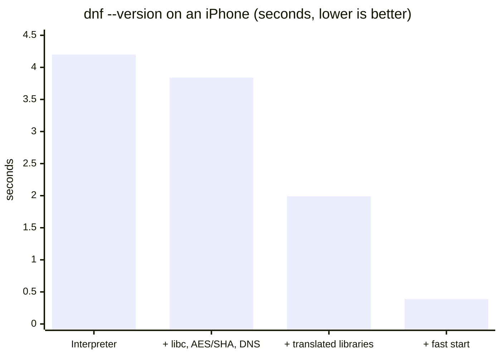

# Performance

iOS lets no app generate machine code at run time, so Pocket Distro interprets every Linux program. This page shows where that costs time, what the app does about it, and how each number was measured. All outputs below were checked against the plain interpreter's: a speed-up that changes a program's output is not shipped.

## On an iPhone: `dnf --version`, AlmaLinux 10

| Step | `dnf --version` | Build |
|---|---:|---|
| Interpreter only | 4.2 s | 54 |
| + glibc's string functions on the host, hardware AES/SHA, DNS fix | 3.84 s | — |
| + libraries translated ahead of time | 1.99 s | 58 |
| + fast start (dnf resumes a saved process) | **0.39 s** | 60 |
| First run after installing or repairing (saves the snapshot) | 2.3 s | 60 |

Other measurements on the same phone:

| Workload | Before | Now | What changed |
|---|---:|---:|---|
| `dnf makecache`, cold | 2 min 22 s | 1 min 27 s | DNS: IPv4 and IPv6 questions in turn (one of two parallel answers was lost on the phone's network; every download waited out a timeout) |
| First `dnf` after Repair | 13 s | 2.3 s | unpacking keeps modification times (Python had recompiled every module) |
| Python loop, 1M iterations, AlmaLinux (translated libraries) | — | 1.33 s | |
| Python loop, 1M iterations, Debian, interpreter | — | 2.9–3.1 s | |
| Python loop, 1M iterations, Debian, accelerated engine (⚡) | — | 1.2–1.4 s | |

Reading: for AlmaLinux's package tools the native engine with translated libraries and the fast start is the fastest path; it matches the WebAssembly engine on a hot Python loop and leads clearly on dnf, which runs a lot of code once.

## In CI (arm64 Linux runner), AlmaLinux 10.3

The same programs natively (chroot on the runner) and in the engine (`lxrun`, interpreter only), from the core repository's `bench-almalinux` job:

| Workload | Native | Engine, start | Engine, now |
|---|---:|---:|---:|
| `dnf install httpd` | 0.91 s | 37.0 s | 22.5 s |
| `dnf install tmux` | 0.62 s | 22.8 s | 15.3 s |
| `rpm -qa` | 0.05 s | 5.0 s | 3.1 s |
| `dnf makecache`, cached | 0.47 s | 14.0 s | 10.0 s |
| `dnf makecache`, cold | 3.0 s | 130 s | 101 s |

The engine executes the same number of guest instructions as the native run (530 M vs 527 M for `dnf --version`): the time is interpretation, not system calls.

### Libraries translated ahead of time

14 libraries of AlmaLinux's dnf stack (libpython, libsqlite, librpm, librpmio, rpm-sequoia, libsolv, libsolvext, libdnf, libcrypto, libcurl, libxml2, libglib, bash, the dynamic loader), the functions that hold 99% of each library's samples in a training run:

| Command | Interpreter | Translated | Saved |
|---|---:|---:|---:|
| `dnf --version` | 4.99 s | 3.40 s | 32% |
| `dnf -C search nginx` | 9.15 s | 5.94 s | 35% |
| `dnf -C info httpd` | 9.07 s | 5.79 s | 36% |
| `dnf -C list --available` | 18.03 s | 10.88 s | 40% |
| `rpm -qa` | 3.77 s | 3.09 s | 18% |
| Python, json + re | 7.18 s | 5.40 s | 25% |
| `dnf install tmux` | 15.99 s | 10.28 s | 36% |

On the phone the saving was larger (48% for `dnf --version`).

### Fast start

| Command | Plain | Fast start |
|---|---:|---:|
| `dnf --version` | 4.84 s | 0.9 s |
| `dnf -C search nginx` | 8.97 s | 5.63 s |
| `yum -C list --installed bash` | 6.15 s | 2.80 s |
| `dnf -C repolist` | 5.55 s | 2.20 s |

Interpreter only, without the translated libraries; the runner's numbers include 0.55 s of starting `lxrun` and `bash`, which the app does not pay (its shell is already running). The snapshot is 21 MB; loading it takes 0.34 s on the runner. What remains of `dnf --version` is mostly dnf reading the package database (0.4 s).

### The accelerated engine (⚡) on the same commands

Node's V8 stands in for WebKit's JavaScriptCore here, so only the ratios mean something:

| Command | Native interpreter | WebAssembly interpreter | WebAssembly + translation |
|---|---:|---:|---:|
| `dnf --version` | 4.82 s | 9.53 s | 9.18 s |
| `dnf -C search nginx` | 9.07 s | 17.27 s | 14.59 s |
| Python, json + re | 7.15 s | 15.00 s | 9.48 s |
| Python loop, 1M | 4.35 s | 9.25 s | 4.55 s |

## How each number is measured

| Numbers | Where |
|---|---|
| Phone | `time` in a tab of a TestFlight build, after Settings › Distributions › Repair (a fresh image) |
| CI, native vs engine | core repository, `tests/linux/bench_dnf.sh` (`bench-almalinux` job, JSON artifact per run) |
| Where the time goes | `LXRUN_PROF` (a sample of the guest's program counter every millisecond of CPU), `tests/linux/prof_resolve.py` with AlmaLinux's debuginfo packages |
| Translated libraries | `tools/aot-build.sh` here (built for every TestFlight build; it refuses tables whose outputs differ) |
| Fast start | core repository, `tools/explore/zygote2.sh`; correctness in CI by `tests/linux/run_zygote.sh` |
| Accelerated engine | core repository, `tools/explore/accel_alma.sh` |

## What does not get faster

- Heavy computing in programs that are not among the translated libraries (compilers, your own native code) runs at interpreter speed; the accelerated engine helps there in Debian tabs.
- The translated libraries match the exact builds of the AlmaLinux image the app was built with. After a `dnf upgrade` replaces one of them, that library runs interpreted until the app's next build carries tables for the new version; nothing breaks.
- One core per process (threads take turns); no GPU.
